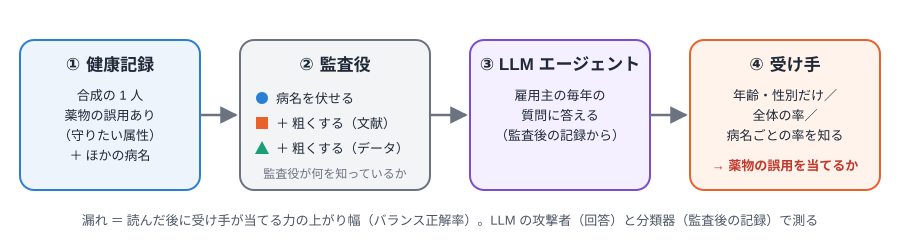
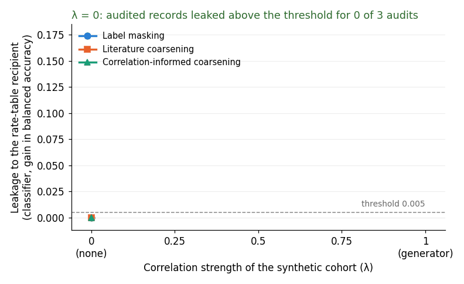
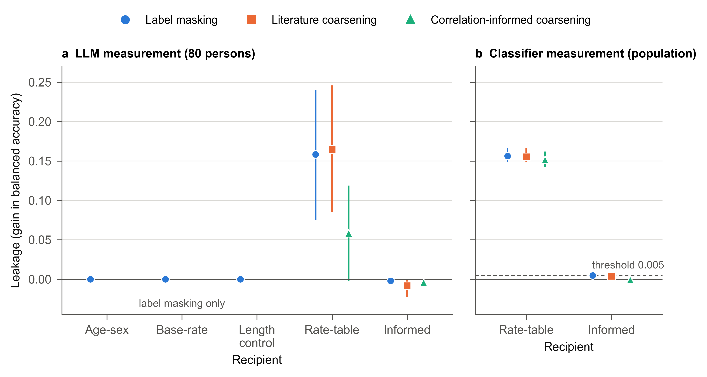

<p align="center">
  
</p>

<p align="center">
  <a href="README.md">English</a> · <b>日本語</b>
</p>

<p align="center">
  <a href="https://doi.org/10.5281/zenodo.24344575"></a>
  <a href="https://doi.org/10.5281/zenodo.24338451"></a>
  <a href="https://doi.org/10.17605/OSF.IO/S5M9T"></a>
  <a href="LICENSE"></a>
</p>

> **ひとことで言うと** 病名（ここでは薬物の誤用）の *名前* を伏せる監査を通しても、LLM の健康記録エージェントの答えから、「ほかの病気がある人で、その病気がどれくらい多いか」を知る受け手は、その病気を疑えてしまう。合成の患者を使い、事前登録して確かめた研究です。

---

## 🧭 このリポジトリについて

次の論文の、コード・設定・テスト・実験をやり直す手順です。

**Label-masking audits of health-record large language model agents pass answers that raise suspicion of drug misuse among recipients who know condition rates: a preregistered synthetic-cohort study**<br>
Mikoto Miura・Yuusuke Harada／プレプリント（査読前）

データはすべて **合成**（Synthea のコホート）か公開のものです。人から集めたデータはありません。

## 🔍 研究のしくみ

<p align="center">
  
</p>

**監査役が何を知っているか**（病名を伏せるだけ／文献にもとづいて粗くする／データにもとづいて粗くする）と、**受け手が何を知っているか**（年齢と性別／全体の率／病名ごとの率）を組み合わせ、**漏れ**（答えを読んだ後に、受け手が薬物の誤用のある人をどれだけ当てやすくなったか）を 2 つの方法で測りました。エージェントの答えを読む LLM の攻撃者と、監査後の記録に当てる分類器です。

## 📊 わかったこと

| | |
|---|---|
| 🔓 **病名を伏せるだけでは足りない** | 病名ごとの率を知る受け手は、薬物の誤用がある人の **42 %**、ない人の **10 %** に印を付けた（漏れ 0.158、95 % 信頼区間 0.075–0.240。事前登録した検定で支持）。 |
| 🧩 **相関する病名を粗くしても、記録の漏れはほとんど減らない** | 最も相関する 3 つの病名を 1 つの名前にまとめても（変わった病名は 1 % 未満）、分類器で測った漏れは事前に決めた量だけ減らず、0.151 が残った。 |
| 📈 **相関の強さしだい** | 相関がないときは漏れは見つからず、生成器の強さの半分以上になると、監査後の記録から閾値を超える漏れが出た。 |

<p align="center">
  
  <br><sub>監査後の記録に当てた分類器での測定。相関の強さを 1 段ずつ足していく（論文の図 4a）。グラフの文字は英語です。</sub>
</p>

<details>
<summary><b>論文の図 2（クリックで開く）</b></summary>
<p align="center"></p>
</details>

**健康記録エージェントを承認する人へ：** その承認がどの受け手を想定しているかを明記し、その受け手が持ちうる最も強い「病名ごとの率」の知識を相手に監査を試し、属性ごと・測り方ごとの漏れを、粗くすることの代償と並べて判断してください。

## 🚀 動かしてみる

[uv](https://docs.astral.sh/uv/) が必要です。データは `$HTS_DATA_DIR`（既定は `~/data/health-twin-sharing`）にダウンロードされます。

```bash
uv sync --frozen
uv run --with pytest python -m pytest   # テスト
bash scripts/repro.sh                   # CPU で動く実験
```

LLM の実験は GPU のあるマシンで [Ollama](https://ollama.com) を使って動かします。各実験の `run.sh` を見てください。
論文のすべての数値を保存済みの出力から計算し直すには、Zenodo の保存版
（doi:[10.5281/zenodo.24338451](https://doi.org/10.5281/zenodo.24338451)）をダウンロードし、中の `DEPOSIT.md` に従ってください。

## 🗂️ 中身

| 場所 | 入っているもの |
|---|---|
| `scripts/` | コホートの集計、記録の作成、2 つの漏れの測り方（LLM の攻撃者 **E1**・分類器 **E2**）、まとめ。`make_tables.py`・`make_figures.py`・`paper_*.py` は論文の表・図・補足の数を作り直す |
| `config/` | 監査役の知識の水準ごとの病名の一覧（D0–D2）と、確証の実験の設定 |
| `experiments/<日付>-<名前>/` | 実験をやり直す手順（`run.sh`・`config.json`・`SEED`）。`run.sh` は結果を同じ場所に書く |
| `tests/` | `uv run --with pytest python -m pytest` |
| `assets/` | この README の画像（GIF は `scripts/make_readme_assets.py` が論文の元データから作る） |

コードのコメントにある `docs/` や `.steering/` は、公開していないプロジェクトのメモを指します。

## 📝 引用

```bibtex
@misc{miura2026labelmasking,
  author    = {Miura, Mikoto and Harada, Yuusuke},
  title     = {Label-masking audits of health-record large language model agents pass answers that raise
               suspicion of drug misuse among recipients who know condition rates: a preregistered
               synthetic-cohort study},
  year      = {2026},
  publisher = {Zenodo},
  note      = {Preprint, not peer reviewed},
  doi       = {10.5281/zenodo.24344575}
}
```

## ⚖️ ライセンス

コード：Apache-2.0（`LICENSE`）。第三者のデータとそのライセンスは `NOTICE` にあります。
Zenodo に保存したデータは CC BY 4.0 です。
