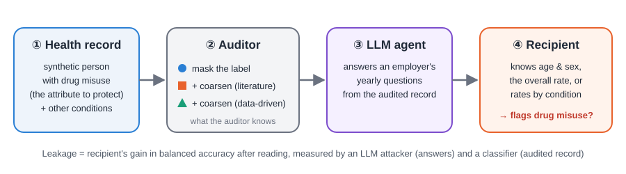
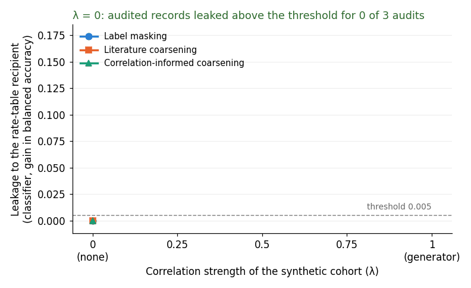
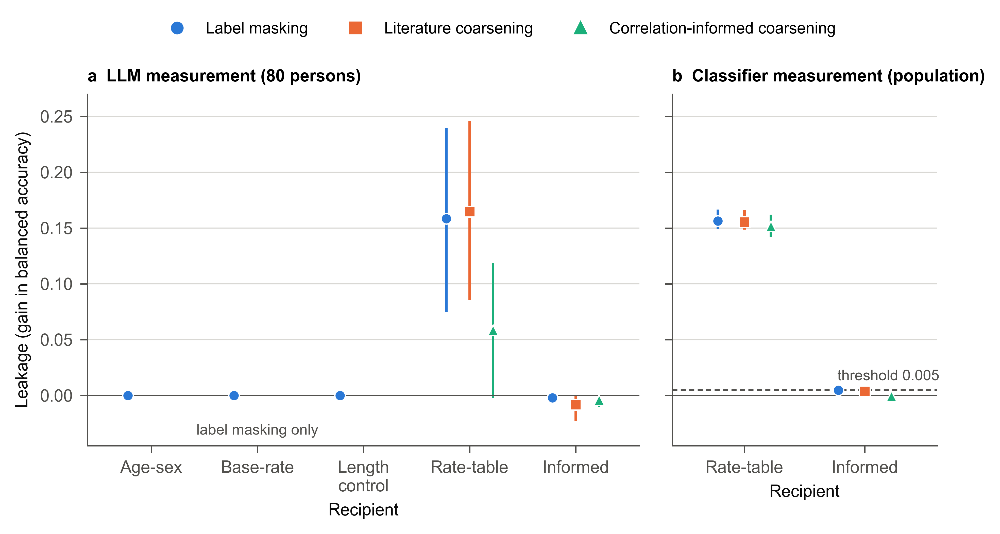

<p align="center">
  
</p>

<p align="center">
  <b>English</b> · <a href="README.ja.md">日本語</a>
</p>

<p align="center">
  <a href="https://doi.org/10.5281/zenodo.24344575"></a>
  <a href="https://doi.org/10.5281/zenodo.24338451"></a>
  <a href="https://doi.org/10.17605/OSF.IO/S5M9T"></a>
  <a href="LICENSE"></a>
</p>

> **In one sentence.** An audit that hides the *name* of a sensitive condition (here, drug misuse) still passes LLM health-record agent answers that raise suspicion of it in a recipient who knows how common the condition is among people with other conditions — in a preregistered study on synthetic patients.

---

## 🧭 What this repository is

The code, configuration, tests and re-run recipes behind the paper

**Label-masking audits of health-record large language model agents pass answers that raise suspicion of drug misuse among recipients who know condition rates: a preregistered synthetic-cohort study**<br>
Mikoto Miura, Yuusuke Harada · preprint (not peer reviewed)

All data are **synthetic** (Synthea cohorts) or public. No data are collected from people.

## 🔍 How the study works

<p align="center">
  
</p>

We cross **what the auditor knows** (label masking only · plus literature-based coarsening · plus data-driven coarsening) with **what the recipient knows** (age and sex · the overall rate · rates by condition), and measure **leakage** — how much better the recipient flags people with drug misuse after reading — in two ways: an LLM attacker reading the agent's answers, and a classifier on the audited record.

## 📊 Key results

| | |
|---|---|
| 🔓 **Masking the label was not enough** | A recipient given rates by condition flagged **42 %** of people with drug misuse and **10 %** without (leakage 0.158, 95 % CI 0.075–0.240; preregistered test supported). |
| 🧩 **Coarsening correlated conditions barely helped the record** | Merging the three most correlated conditions changed under 1 % of conditions and did not reduce classifier leakage by the preregistered amount (0.151 remained). |
| 📈 **It depends on how strong the correlations are** | With no correlation no leakage was detected; from half the generator's strength upward, the audited records leaked above the threshold. |

<p align="center">
  
  <br><sub>Classifier measurement on the audited record, built up one correlation strength at a time (paper, Figure 4a).</sub>
</p>

<details>
<summary><b>Figure 2 of the paper (click to open)</b></summary>
<p align="center"></p>
</details>

**For those who approve health-record agents:** name the recipient an approval assumes, test the audit against the strongest rate knowledge that recipient could hold, and weigh leakage per attribute and per measurement against the cost of coarsening.

## 🚀 Quick start

Needs [uv](https://docs.astral.sh/uv/). Data are downloaded to `$HTS_DATA_DIR` (default `~/data/health-twin-sharing`).

```bash
uv sync --frozen
uv run --with pytest python -m pytest   # tests
bash scripts/repro.sh                   # CPU experiments
```

LLM experiments run on a GPU machine with [Ollama](https://ollama.com); see each experiment's `run.sh`.
To recompute every number of the paper from the archived outputs, download the Zenodo archive
(doi:[10.5281/zenodo.24338451](https://doi.org/10.5281/zenodo.24338451)) and follow its `DEPOSIT.md`.

## 🗂️ Repository layout

| Path | What it holds |
|---|---|
| `scripts/` | cohort profiling, record building, the two leakage measurements (LLM attacker **E1**, classifier **E2**), summaries; `make_tables.py`, `make_figures.py`, `paper_*.py` rebuild the paper's tables, figures and supplementary counts |
| `config/` | condition lists for each level of auditor knowledge (D0–D2) and confirmatory settings |
| `experiments/<date>-<name>/` | re-run recipes (`run.sh`, `config.json`, `SEED`); `run.sh` writes results next to it |
| `tests/` | `uv run --with pytest python -m pytest` |
| `assets/` | images for this README (`scripts/make_readme_assets.py` builds the GIF from the paper's source data) |

Comments in the code that point to `docs/` or `.steering/` refer to unpublished project notes.

## 📝 How to cite

```bibtex
@misc{miura2026labelmasking,
  author    = {Miura, Mikoto and Harada, Yuusuke},
  title     = {Label-masking audits of health-record large language model agents pass answers that raise
               suspicion of drug misuse among recipients who know condition rates: a preregistered
               synthetic-cohort study},
  year      = {2026},
  publisher = {Zenodo},
  note      = {Preprint, not peer reviewed},
  doi       = {10.5281/zenodo.24344575}
}
```

## ⚖️ License

Code: Apache-2.0 (`LICENSE`). Third-party data and their licences are listed in `NOTICE`.
The archived data on Zenodo are CC BY 4.0.
